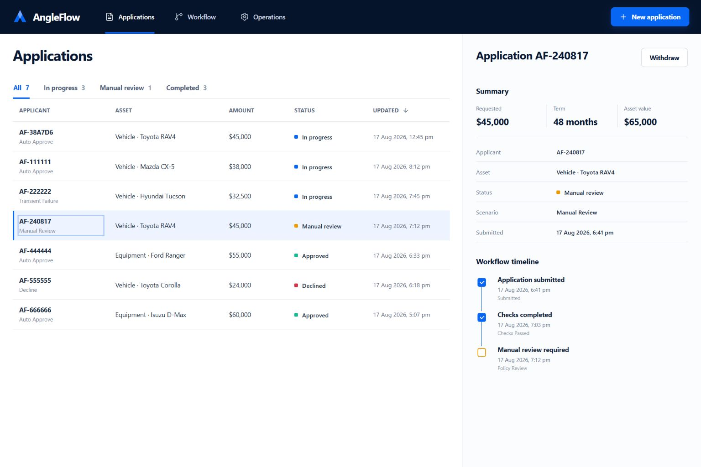
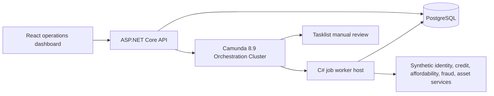

# AngleFlow

[](https://github.com/skinnyfatboy/angleflow/actions/workflows/ci.yml)


AngleFlow is an asset-finance application workflow built to demonstrate production-minded automation with Camunda, BPMN/DMN, C#, .NET, PostgreSQL, React, Docker, and Azure infrastructure as code.

It accepts a finance application, runs five independent checks in parallel, evaluates the result through a DMN decision table, and routes the case to automatic approval, human review, or decline. It also demonstrates withdrawal messages, SLA escalation, retry recovery, incidents, idempotent external work, and a sequenced audit trail.

> All applicants and outcomes in this repository are synthetic. This is a portfolio system, not lending software and not financial advice.



## What it demonstrates

- Executable BPMN 2.0 orchestration with parallel service tasks, gateways, a user task, timer boundary event, and interrupting message event subprocess.
- DMN 1.3 decision logic for identity, credit, affordability, fraud, and asset confidence.
- Eleven resilient C# job workers using the official `Camunda.Orchestration.Sdk` 9.1.1.
- ASP.NET Core minimal APIs with idempotency keys, problem details, correlation IDs, Swagger, and privacy-safe public views.
- PostgreSQL persistence with optimistic concurrency, unique external-operation keys, and ordered audit events.
- React operations dashboard with filtering, application detail, timeline, and synthetic-case creation.
- Repeatable local execution through Docker Compose and a real Camunda 8.9 runtime.
- Compiled Azure Bicep for AKS, ACR, private PostgreSQL, Key Vault, Log Analytics, workload identity, and network isolation.
- GitHub Actions for backend, frontend, containers, Kubernetes rendering, and Bicep compilation.

Camunda currently labels its C# SDK a technical preview for 8.9, so this project pins the matching 9.x SDK and calls that constraint out explicitly. See the [official C# SDK support note](https://docs.camunda.io/docs/apis-tools/csharp-sdk/) and [SDK versioning guidance](https://docs.camunda.io/docs/apis-tools/csharp-sdk/installation/).

## Architecture



The code follows a small layered layout:

```text
src/AngleFlow.Domain          domain rules and state transitions
src/AngleFlow.Infrastructure PostgreSQL, services, Camunda gateway
src/AngleFlow.Api             HTTP contracts and operational middleware
src/AngleFlow.Worker          Camunda resource deployment and job workers
process/                      BPMN, DMN, and Camunda form
web/                          React/Vite operations dashboard
tests/                        domain, persistence, API, workflow, worker tests
infra/azure/                  Azure Bicep baseline
deploy/k8s/                   hardened application manifests
```

See [architecture.md](docs/architecture.md) for the workflow and reliability decisions.

## Run locally

Prerequisites: Docker Desktop or Docker Engine with Compose v2. No local .NET, Node.js, PostgreSQL, or Camunda installation is required.

```powershell
Copy-Item .env.example .env
docker compose up -d --build --wait
```

Open:

- Dashboard: <http://localhost:3000>
- API Swagger: <http://localhost:8088/swagger>
- Camunda Operate: <http://localhost:8080/operate>
- Camunda Tasklist: <http://localhost:8080/tasklist>

The local Camunda credentials are `demo` / `demo`. The Compose profile uses embedded H2 and an unprotected local API configuration from Camunda's developer distribution; it is intentionally limited to local development.

Stop the stack without deleting its data:

```powershell
docker compose down
```

To remove only the project’s disposable local Docker volumes as well:

```powershell
docker compose down --volumes
```

## Try the workflow

Create a deterministic automatic-approval case:

```powershell
$body = @{
  applicantName = 'Synthetic Applicant'
  email = 'applicant@example.test'
  annualIncome = 120000
  monthlyExpenses = 3500
  assetType = 'vehicle'
  assetValue = 65000
  requestedAmount = 45000
  termMonths = 48
  scenario = 'auto-approve'
} | ConvertTo-Json

Invoke-RestMethod `
  -Method Post `
  -Uri 'http://localhost:8088/api/applications/' `
  -Headers @{ 'Idempotency-Key' = 'readme-demo-001' } `
  -ContentType 'application/json' `
  -Body $body
```

Available deterministic scenarios:

| Scenario | Expected behavior |
|---|---|
| `auto-approve` | All checks pass, offer created, application approved |
| `manual-review` | DMN routes to a Tasklist user task |
| `decline` | Policy declines the case and sends the decline notification |
| `transient-failure` | Each check fails twice, then succeeds through Camunda retries |
| `incident` | Check retries exhaust and produce active Camunda incidents |

Run the automated live scenario matrix after the stack is healthy:

```powershell
./scripts/smoke-test.ps1
```

## API surface

| Method | Route | Purpose |
|---|---|---|
| `POST` | `/api/applications` | Submit a validated, idempotent application |
| `GET` | `/api/applications` | List and filter public application views |
| `GET` | `/api/applications/{id}` | Read one application |
| `GET` | `/api/applications/{id}/timeline` | Read its ordered audit timeline |
| `POST` | `/api/applications/{id}/withdraw` | Correlate an interrupting withdrawal message |
| `GET` | `/health/live` | Liveness signal |
| `GET` | `/health/ready` | Readiness signal |

Applicant name, email, and income details are accepted for workflow processing but deliberately excluded from public list/detail responses.

## Test and build

```powershell
dotnet test AngleFlow.sln

Push-Location web
npm ci
npm test
npm run build
Pop-Location

docker compose config --quiet
docker compose build api worker web
kubectl kustomize deploy/k8s
```

The latest verified run is recorded in [live-verification-2026-08-17.md](docs/evidence/live-verification-2026-08-17.md). More detail is in [testing.md](docs/testing.md).

## Azure deployment baseline

The project includes an Azure deployment baseline, not a claim that this public demo is currently hosted in Azure. `infra/azure/main.bicep` provisions:

- AKS with Azure CNI Overlay, Cilium, OIDC issuer, workload identity, stable upgrades, and Log Analytics;
- ACR with managed-identity pull permissions;
- PostgreSQL Flexible Server 16 on a delegated private subnet and private DNS;
- Key Vault with RBAC and soft-delete protection; and
- environment-aware development/production sizing.

Camunda recommends Kubernetes and Helm for production Self-Managed installations. The included AKS notes use its official Helm repository and pin the 8.9-compatible chart line. See [azure-deployment.md](docs/azure-deployment.md) and Camunda's [production Helm guide](https://docs.camunda.io/docs/self-managed/deployment/helm/install/production/).

## Important limitations

- The deterministic provider adapters are synthetic; no credit bureau, identity provider, email provider, or asset registry is contacted.
- EF Core `EnsureCreated` is used for a self-contained demo. A shared production service should use reviewed migrations and a dedicated migration job.
- The local Camunda configuration is single-node and non-production. Production needs TLS, OIDC, backup/restore testing, external supported storage, monitoring, capacity testing, and multi-zone design.
- Azure assets are compile-verified but have not been deployed because this repository does not include an Azure subscription or credentials.
- The official Camunda 8.9 C# SDK is a technical preview and may introduce API changes before full support.

## Documentation

- [Architecture and workflow](docs/architecture.md)
- [Operations runbook](docs/runbook.md)
- [Azure deployment baseline](docs/azure-deployment.md)
- [Testing and evidence](docs/testing.md)
- [Security policy](SECURITY.md)
- [Contributing](CONTRIBUTING.md)

## License

AngleFlow's original source code is available under the [MIT License](LICENSE). Camunda and other dependencies retain their own licenses and trademarks.
