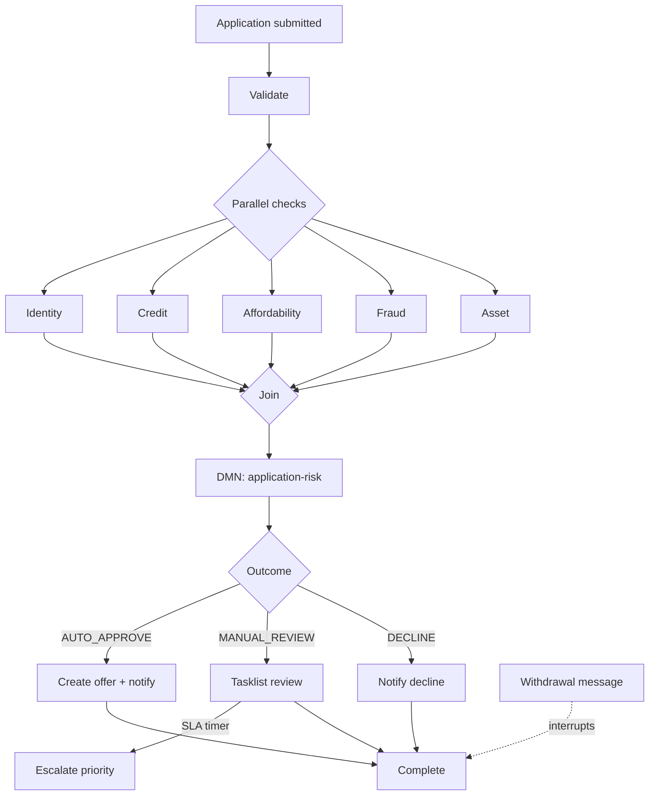

# Architecture and workflow

## Process model

The API stores an application and starts `asset-finance-application`. Camunda validates the command, fans out five service tasks, joins their variables, and evaluates `application-risk` through DMN.

The DMN table uses `FIRST` hit policy. Hard decline rules appear before review rules, and the final catch-all row auto-approves a case that has passed the prior thresholds. Equivalent C# rules exist as a fast unit-test oracle; executable routing remains in DMN.

## Reliability boundaries

### Submission idempotency

`POST /api/applications` requires `Idempotency-Key`. The service hashes the normalized command, stores the key with the application in PostgreSQL, and returns the original application for an equivalent replay. Reusing the key for a different payload returns `409`.

### Worker idempotency

Checks, offers, and notifications carry external-operation keys backed by unique database indexes. A retried job cannot create a second logical side effect. Terminal completion is also idempotent, which protects the withdrawal path when API and worker observations overlap.

### Retries and incidents

Every service task defines three Camunda retries. Unhandled provider exceptions decrement the job retry count. `transient-failure` fails twice and then succeeds; `incident` continues to fail so Camunda creates a `JOB_NO_RETRIES` incident for each check branch.

### Concurrency

Applications contain an EF Core concurrency token. Audit events have a unique `(ApplicationId, Sequence)` index. Withdrawal reloads state after message publication and accepts the worker's terminal write if it wins the race. The clean Compose boot also sequences schema ownership through API readiness before starting workers.

### Audit and privacy

Audit rows capture event type, resulting status, reason code, timestamp, and monotonic per-application sequence. Public API responses exclude applicant name, email, income, and monthly expenses; the operations dashboard uses application reference IDs instead.

## Runtime ownership

| Component | Owns |
|---|---|
| API | validation entry point, idempotency, query contracts, withdrawal publication |
| Camunda | process state, retries, incidents, timers, human task routing |
| Worker host | resource deployment and 11 job handlers |
| PostgreSQL | application, audit, check, offer, notification, idempotency records |
| React dashboard | privacy-safe operations view and synthetic submissions |

## Intentional trade-offs

- The worker deploys BPMN/DMN/forms on startup for a self-contained demo. A scaled production environment should promote versioned resources once per release.
- `EnsureCreated` makes local onboarding reliable. Production should use controlled migrations with backward-compatible rollout rules.
- Synthetic check engines make failure modes repeatable and testable; provider interfaces are the seam for real integrations.
- The local Camunda 8 Run profile chooses a small single-node footprint. It is not an HA topology.
